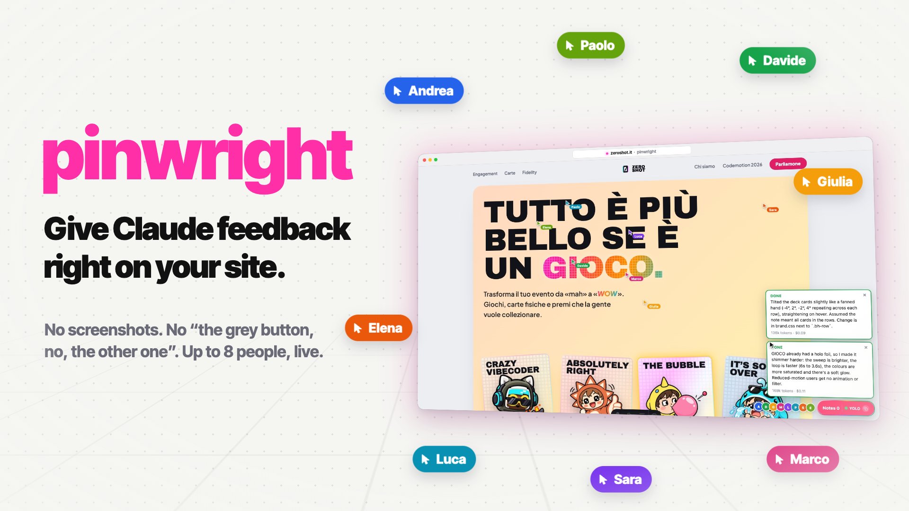

# pinwright

**Give Claude feedback right on your dev site.** Click the element that's wrong, write what you want, and a
Claude agent edits your source while you keep reviewing. Up to 8 people can review the same page live.



Asking a coding agent to fix a page usually goes: take a screenshot, switch to the terminal, paste it,
describe the component ("the grey button under the title, no, the other one"), wait, switch back, check.
pinwright removes the round trip. The note is attached to the element you clicked, so the agent already
knows its selector, markup, computed styles and the page it lives on. It finds the source, edits it, and the
page updates through your dev server's HMR.

- **Point and write.** ⌥ + click anywhere, or press **N**, click an element, type the note.
- **Live edits.** The change lands on the page while the agent works; the note gets a summary, the cost,
  the diff and an **Undo** button.
- **Parallel agents.** Notes that touch different files run side by side.
- **Live sessions.** One link, up to 8 people on the same page, everyone's cursor visible, every note shared.
- **You stay in control.** Guest notes wait for your approval, and agents work inside strict guardrails.

## Set it up with Claude

Open Claude Code in your project's folder and paste this. It installs pinwright, wires it into your
framework and checks that it starts.

```text
Set up pinwright (https://github.com/andreamazzatxt/pinwright) in this project, so I can leave notes on the
dev site and Claude agents apply them to the code.

1. Check that Node is >= 22.13 and that Claude Code is logged in. If it isn't, stop and tell me to run `claude login`.
2. Install @andreamazza/pinwright as a dev dependency, with the package manager this project already uses.
3. Find the framework and wire pinwright in, dev mode only:
   - Vite, SvelteKit, React Router, SolidStart, Qwik: add `pinwright()` from '@andreamazza/pinwright/vite' to the Vite plugins.
   - Astro: add `pinwright()` from '@andreamazza/pinwright/astro' to `integrations`.
   - Nuxt: add '@andreamazza/pinwright/nuxt' to `modules`.
   - Next.js: wrap the exported config with `withPinwright` from '@andreamazza/pinwright/next', and render
     `<Pinwright />` from '@andreamazza/pinwright/next/script' at the end of <body> in the root layout
     (app router) or in pages/_document (pages router).
   - Webpack 5, Rspack, Rsbuild: add `new PinwrightPlugin()` from '@andreamazza/pinwright/rspack' to `plugins`.
   - Anything else: add a "pinwright" script running `pinwright --target <dev server URL>`.
4. Change nothing else. Production builds must stay exactly as they are.
5. Start the dev server and check its log prints "[pinwright] listening on …", then stop it.
6. Tell me which URL to open and that I can hold ⌥ and click any element to leave a note.
```

## Manual setup

Requirements: Node ≥ 22.13 and Claude Code logged in (`claude login`). pinwright uses your Claude Code
subscription by default; no API key needed.

```sh
npm i -D @andreamazza/pinwright
```

| Framework | Setup |
| --- | --- |
| Vite, SvelteKit, React Router, SolidStart, Qwik | `plugins: [pinwright()]` in `vite.config`, from `@andreamazza/pinwright/vite` |
| Astro | `integrations: [pinwright()]` in `astro.config`, from `@andreamazza/pinwright/astro` |
| Nuxt | `modules: ['@andreamazza/pinwright/nuxt']` in `nuxt.config` |
| Next.js | `withPinwright(config)` + `<Pinwright />` in the root layout (below) |
| Webpack 5, Rspack, Rsbuild | `plugins: [new PinwrightPlugin()]`, from `@andreamazza/pinwright/rspack` |
| Anything else | `npx pinwright --target <dev server URL>` (proxy) |

The daemon starts and stops with your dev server. Nothing is added to production builds.

<details>
<summary>Code for each framework</summary>

**Vite** (and every framework built on it):

```js
// vite.config.js
import pinwright from '@andreamazza/pinwright/vite'
export default { plugins: [pinwright()] }
```

The plugin puts the overlay into every HTML page the Vite dev server sends, server-rendered ones included.

**Astro**

```js
// astro.config.mjs
import pinwright from '@andreamazza/pinwright/astro'
export default { integrations: [pinwright()] }
```

**Nuxt**

```js
// nuxt.config.ts
export default defineNuxtConfig({ modules: ['@andreamazza/pinwright/nuxt'] })
```

**Next.js** (Turbopack or webpack)

```js
// next.config.js
import { withPinwright } from '@andreamazza/pinwright/next'
export default withPinwright({ /* your config */ })
```

```jsx
// app/layout.jsx
import { Pinwright } from '@andreamazza/pinwright/next/script'

export default function RootLayout({ children }) {
  return (
    <html lang="en">
      <body>
        {children}
        <Pinwright />
      </body>
    </html>
  )
}
```

`<Pinwright />` renders nothing outside `next dev`. With the pages router, put it in `pages/_document`.

**Webpack 5 / Rspack / Rsbuild**

```js
// rspack.config.js (or webpack.config.js; with Rsbuild, under tools.rspack.plugins)
import { PinwrightPlugin } from '@andreamazza/pinwright/rspack' // same plugin as '/webpack'
export default { plugins: [new PinwrightPlugin()] }
```

It runs in watch mode only (dev server, `--watch`) and adds a small entry that loads the overlay.

**Any other stack (proxy)**

```sh
npx pinwright --target http://localhost:3000
# then open http://localhost:4340/
```

pinwright sits in front of your dev server and injects the overlay; HMR websockets pass through. If your server
has no HMR, pass a rebuild command with `--rebuild ./scripts/rebuild.sh`: it runs after edits and open pages
reload at the same scroll position.

All plugins take the same options as the config file: `pinwright({ port: 4350 })`.

</details>

## Writing notes

Hold **⌥** and click anywhere to drop a note; the cursor turns into a pin while ⌥ is down. Or press **N** to
enter note mode, then click.

A small local daemon queues the note and a Claude agent picks it up. The agent never stops to ask: if a note
is ambiguous it picks the likeliest reading, applies it and says what it assumed. Reply on the pin ("not
quite, make it smaller") and the same agent session resumes.

The agent doesn't verify its own work: no screenshots, builds or tests. You are the check, looking at the
page. That keeps notes fast and cheap. Set `ask: true` if you'd rather the agent ask a question (a `?` on
the pin) than guess.

## Live sessions

Open the notes list and press **Go live**. pinwright opens a Cloudflare quick tunnel and gives you a link with
a secret token. Anyone with the link (up to 8 people in all) sees the site and every note, adds notes and
replies, and sees everyone's cursor, each with its own colour and a made-up name they can change. Guests only
need a browser.

The **YOLO mode** switch picks which link you copy. It's off every time the page loads.

- **Off:** guests' notes, replies and retries wait as *To approve* until you press **Approve** (or
  **Discard**). A toast tells you when one arrives.
- **On:** guests' notes go straight to the agents, like yours. Give this link only to people you'd let edit
  your code.

Both links stay valid at the same time. **Stop** closes the tunnel and voids them. Guests can't share,
approve, or read the daemon's status.

pinwright uses the `cloudflared` on your PATH if there is one. Otherwise, on the first share it downloads
Cloudflare's official build from their GitHub releases into `~/.cache/pinwright` (once per machine; on macOS
the binary must carry Cloudflare's signature). Set `cloudflared` in the config to use your own binary.

## Guardrails

Each note runs in its own Claude Agent SDK session with only the note in the prompt (text, page, selector,
outerHTML, computed styles) plus your project's `CLAUDE.md`.

- Reads and edits only inside the project root, never `.git`, `node_modules` or `.pinwright`.
- No shell edits, no git history commands, no network, no installs, so undo always works.
- No note may change what runs code on the next install, build or dev start: `package.json`, lockfiles,
  `*.config.*`, `.env*`, shell scripts, Dockerfiles, CI and editor folders.
- **Guest notes** may only edit files under source and asset folders (`src/`, `public/`, `app/`, `pages/`,
  `components/`, `styles/`, `assets/`…, configurable with `guestDirs`) and can't read secrets (`.env*`, keys,
  certificates), so nothing private can be copied into the page.
- The daemon binds `127.0.0.1` and only answers pages from localhost, plus visitors who arrive through the
  tunnel with its token (exchanged once for an HttpOnly, SameSite cookie).

## Config

`pinwright.config.mjs` in the project root. Everything is optional; plugin options and CLI flags override it.

```js
export default {
  target: 'http://127.0.0.1:4330',   // proxy mode only
  port: 4340,
  rebuild: './scripts/rebuild.sh',   // proxy mode without HMR
  rebuildOnEdit: true,               // rebuild after every edit, not only at the end
  ask: false,                        // let the agent ask a question instead of guessing
  maxAgents: 3,                      // notes running at once
  models: { planner: 'haiku', worker: 'sonnet' }, // planner: false skips planning
  viewports: [{ name: 'mobile', width: 390, height: 844 }, { name: 'desktop', width: 1440, height: 900 }],
  shots: false,                      // before/after thumbnails (needs Chrome and playwright-core)
  maxTurns: 30,
  timeoutMin: 20,
  lang: 'en',                        // overlay and agent language: 'en' or 'it'
  instructions: '',                  // appended to the agent's system prompt
  guestDirs: ['src', 'public'],      // folder names guest notes may edit under (default: common source/asset dirs)
  cloudflared: '/path/to/cloudflared',
  useApiKey: false,                  // use ANTHROPIC_API_KEY instead of `claude login`
}
```

## CLI

```
pinwright [start] --target <url>   run the daemon (proxy mode when there's a target)
pinwright list [--all]             notes in the running daemon
pinwright take <id>                mark a note taken and print a prompt for an interactive session
pinwright done <id> [summary]      close a note you handled by hand
pinwright reply <id> <text>        follow up on a note (or answer, with ask: true)
```

To work a note yourself in Claude Code: `claude "$(pinwright take abc123)"`.

## How it works

- **Store:** SQLite (`node:sqlite`) in `.pinwright/`, ignored by git automatically. The queue survives
  restarts; notes left mid-flight go back in the queue.
- **Scheduler:** a Haiku planner predicts which files each note touches. Notes whose files don't overlap run
  in parallel, up to `maxAgents`. Files are also locked at edit time, so a wrong guess only means waiting.
- **Worker:** one Agent SDK session per note. It finds the source, edits, and closes the note through
  in-process tools (`note_done`, `note_handoff`, `note_ask`).
- **Undo** restores the note's files. If another edit changed them since, the note's own patch is reversed on
  top; if that doesn't apply cleanly, undo is refused and lists the files.
- **Live channel:** note events, presence and cursors travel over a WebSocket on `/__pw/ws`, which tunnels
  pass through without buffering.

## License

MIT
